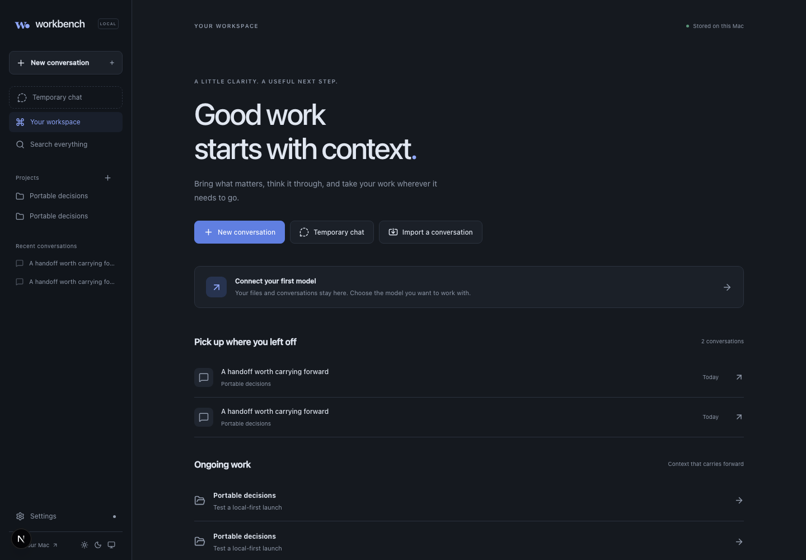
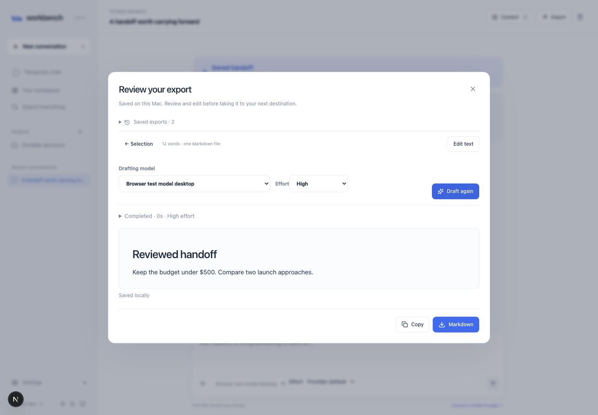
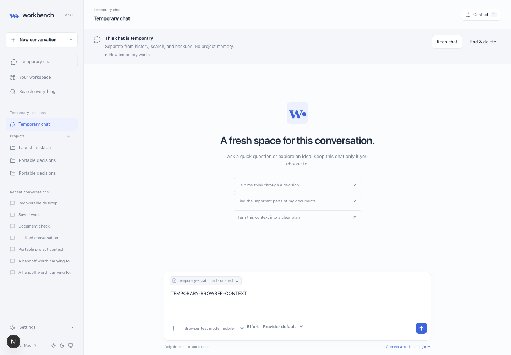

# Local AI Workbench

Keep your conversations, documents, and project decisions in one local workspace. Choose a model for each task, review what context it receives, and carry the result into your next conversation.

Workbench runs on your computer and connects to your own Azure OpenAI or Azure AI Foundry deployments. Your workspace stays local; model requests go to the service you configure.



## What you can do

- **Work across conversations.** Import pasted chats or text and Markdown exports. Review who said what, keep the original, and branch from an earlier turn when you want to try another direction.
- **Choose the context.** Attach documents and inspect their extracted text. Send complete text, selected excerpts, or original images and PDFs when the model supports them. Adding a file to a project does not automatically send it to a model.
- **Keep reviewed project decisions.** An approved project brief carries into new project chats. Proposed changes stay separate until you review and accept them.
- **Use another model for the next step.** Pick the handoff or brief drafting model independently of the chat model. Keep useful answers as editable outputs with revision history.
- **Take the work elsewhere.** Export a handoff, a finished result, or the conversation itself. Review the text, edit it, then copy or download Markdown, a source bundle, or print-friendly HTML.

## New in this update

### Drafts keep running when you leave the page

Closing a drafting window, clicking outside it, or opening another page no longer loses the task. Handoffs and project brief drafts run in the local worker and save their progress. Reopen the conversation or project to pick them up.

**Stop drafting** cancels a task. If the app or worker stops unexpectedly, available partial text remains saved. Paid model requests are not retried automatically. The app and worker must stay running for a task to continue.

### Handoffs that make sense in a new conversation

Handoffs are written for the next task: what you are trying to do, the decisions already made, relevant context, open questions, and what should happen next. They do not require another AI to interpret Workbench's internal record IDs. You can edit the actual export before sharing it, and earlier exports remain available.



### Temporary chats

Start a **Temporary chat** from the home page or sidebar. It has no project memory and stays outside saved history, search, and backups.

Temporary chats survive refresh and navigation. Workbench stores their messages and attachments locally until you choose **End & delete** or leave them inactive for 24 hours. Cleanup runs while the app is running, or when it next starts. Choose **Keep chat** to save the conversation and enable exports, saved outputs, and branching.

This does not change the model provider's retention policy. Local deletion is not a guarantee of forensic disk erasure.



### Reasoning controls

Configure supported controls in **Settings → Your deployments → Reasoning controls**, then choose effort beside the model picker. OpenAI reasoning effort and Anthropic adaptive or budget-based thinking are supported where the deployment accepts them. **Provider default** leaves the setting to the provider.

Response activity shows elapsed request time and any reasoning the API returns. Some models return an answer without a reasoning summary.

## Run it locally

You need **Node.js 22.13 or later**, npm, and an Azure deployment with an API key to use model features. API usage is billed by your provider. Imports, local editing, and ordinary exports do not require a model call; AI drafting does.

```bash
git clone https://github.com/Anirudh-Nadipally/local-ai-workbench.git
cd local-ai-workbench
npm ci
npm run build
PORT=3025 npm start
```

Open [http://127.0.0.1:3025](http://127.0.0.1:3025). The start command runs the web app and worker together; keep the terminal open while using Workbench.

On macOS, you can also open **Start Workbench.command** in the repository folder. It installs missing dependencies, builds the app if needed, and opens your browser.

In **Settings**, enter your endpoint and API key, register a deployment using its deployment name and protocol, and run the text check. Image and PDF checks are separate. Configure reasoning controls only for settings that deployment supports. Capability checks make small, billable API requests.

Current connections support Azure OpenAI and Azure AI Foundry, including Anthropic-protocol deployments through Foundry. Direct OpenAI and Anthropic accounts, arbitrary API endpoints, and local model servers are not connected in this version.

**Coming from the earlier workbench?** This rebuild uses a different database format. Follow the [upgrade guide](docs/UPGRADING.md) to install it alongside the old version and import selected conversations. Do not point it at the old `data/` directory.

## Storage and privacy

The default `data/` directory contains the SQLite database, original uploads, and encrypted connection configuration. It is ignored by Git. The encryption key is stored on the same computer; protect the folder with your operating system's account and disk security.

Requests contain the conversation history, the approved brief when enabled, and the sources you select. Workbench has no telemetry, cloud workspace account, or automatic model switching. It binds to loopback and is intended for one person on one computer.

Backups exclude credentials and temporary chats, but contain saved conversations and files. Treat them as private. Restore requires an empty workspace, validates the archive, preserves that workspace's credentials, and does not restart imported jobs. Deleted saved conversations can be recovered from Trash; **End & delete** for temporary chats is permanent within the app.

## Development and checks

```bash
npm ci
npm run dev
```

Development starts the web app and worker at [http://127.0.0.1:3000](http://127.0.0.1:3000).

```bash
npm run typecheck
npm run lint
npm test
npm run build
npx playwright install chromium
npm run test:recovery
```

The recovery command starts an isolated workspace on port 3042. It tests drafting across dismissal, navigation, and reload, then runs the desktop and mobile workflows. These checks use synthetic data and make no paid model requests. CI runs the same checks.

See [verification](docs/VERIFICATION.md), [architecture](docs/ARCHITECTURE.md), [contributing](CONTRIBUTING.md), and the [security policy](SECURITY.md). The [changelog](CHANGELOG.md) records the release changes.

## Current limits

Conversation import accepts pasted text and text/Markdown files; provider-specific JSON and ZIP chat archives are not supported yet. There is no global personal memory, automatic multi-model orchestration, or local OCR. Scanned PDFs can be sent as originals to a deployment that passes the PDF check.

Licensed under [MIT](LICENSE). Screenshots show synthetic test content.
